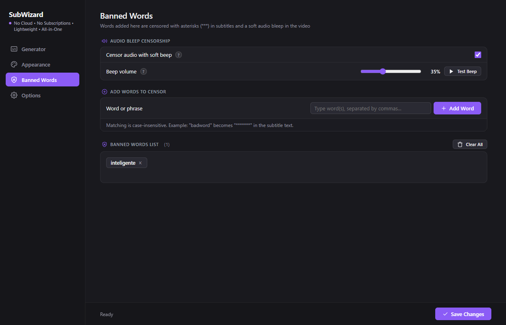
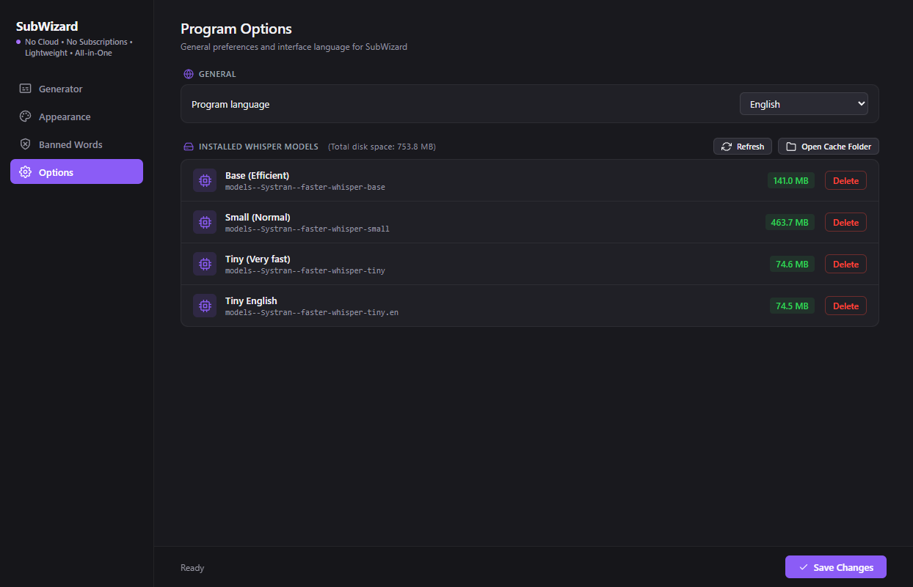

# 🎬 SubWizard — Videos Powered by AI

<p align="center">
  
</p>

<p align="center">
  <a href="https://paypal.me/victorgouveia17">
    
  </a>
  <a href="https://github.com/Victorgm21/subwizard/blob/main/LICENSE">
    
  </a>
  <a href="https://www.python.org/downloads/">
    
  </a>
</p>

**SubWizard** is a desktop application for automated video subtitling and social-media content creation (Shorts, Reels, TikTok). It combines fast AI transcription with animated typography, audio censorship, and batch video processing into a clean desktop interface.

---

## 📸 Screenshots

<details open>
<summary><b>View Screenshots</b></summary>
<br>

| Generator & Batch Processing | Appearance & Animation Studio |
| :---: | :---: |
|  |  |

| Banned Words & Audio Censorship | Program Options & Cache Manager |
| :---: | :---: |
|  |  |

</details>

---

## Features

- **Fast Speech Recognition (`faster-whisper`):**
  - Word-level timestamps for precise animated highlights.
  - Silero VAD (Voice Activity Detection) filter to prevent silence hallucinations.
  - Automatic GPU (`CUDA`) acceleration with fallback to CPU.
  - Multiple accuracy profiles (`Efficient`, `Normal`, `Detailed`, `Ultra-detailed`).
  - Auto-detection and manual selection for dozens of spoken languages.

- **Animated Subtitle Styles:**
  - **Simple (`.srt`):** Standard subtitles.
  - **Karaoke (`.ass`):** Word-by-word highlight synchronization.
  - **Word Pop (`.ass`):** Scale pop effect on the active spoken word.
  - **Zoom In (`.ass`):** Smooth entrance zoom animation per line.

- **Appearance Studio & Live Preview:**
  - Interactive live preview rendering against an actual video frame.
  - Reads installed system fonts automatically.
  - Controls for font family, size, bold, italic, uppercase (ALL CAPS), and punctuation removal.
  - Custom colors for primary text, active highlights, outlines, and background box transparency.
  - Screen positioning (top, center, bottom) and vertical margins.

- **Single File & Batch Processing:**
  - Process individual media files or entire folders in a single run.
  - Reuses the loaded model in memory across batch items.
  - Configurable output: burned video (`.mp4`), subtitle files only (`.srt`/`.ass`), or both.

- **Audio & Text Censorship:**
  - Automatically replaces banned words with asterisks (`***`) in subtitles.
  - Optional audio bleep overlay with volume control and live preview test.

- **Model Cache Manager:**
  - View installed Whisper models and their disk usage.
  - One-click deletion to free up storage space.

- **Bilingual Interface:**
  - Full interface available in English and Spanish.

---

## Roadmap

- [ ] AI podcast highlight auto-clipping.
- [ ] Active-speaker auto-framing (crop landscape 16:9 to vertical 9:16 following speaker faces).
- [ ] Automatic silence and filler-word removal.

---

## Supported Formats

- **Video:** `.mp4`, `.mkv`, `.mov`, `.avi`, `.flv`, `.webm`
- **Audio:** `.mp3`, `.wav`, `.aac`, `.flac`, `.m4a`, `.ogg`

---

## Installation

### Requirements
- Windows 10 / 11 (64-bit)
- Python 3.8+
- *(Optional)* NVIDIA GPU with CUDA for faster transcription

### Quick Start
```bash
git clone https://github.com/Victorgm21/subwizard.git
cd subwizard
pip install -r requirements.txt
python subwizard.py
```
*(FFmpeg is automatically detected or downloaded on the first launch if not found).*

---

## License

This project is licensed under the [MIT License](LICENSE).
