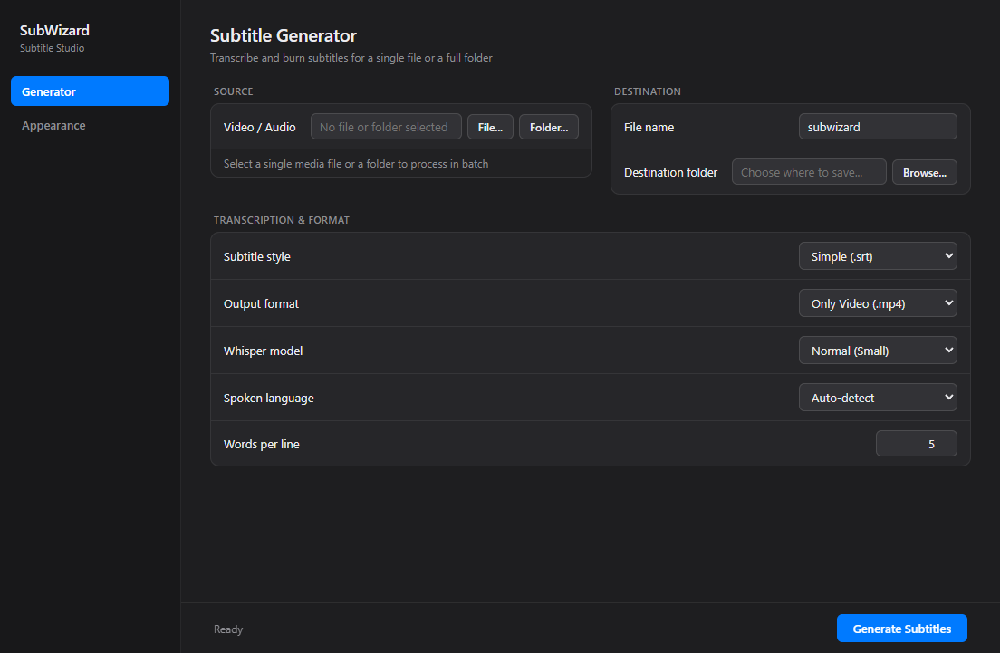
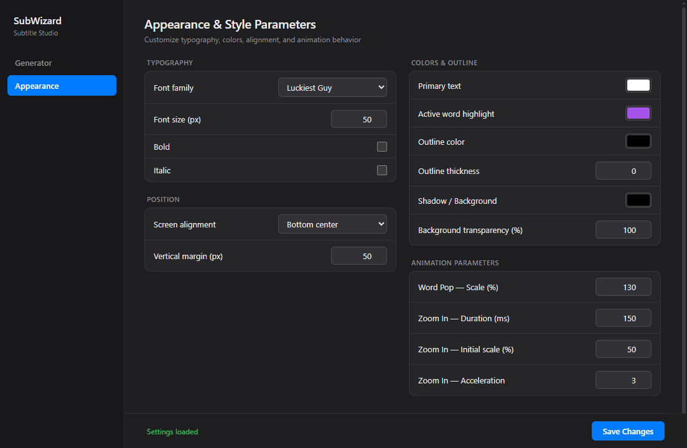

# 🎬 SubWizard: Your Magical Subtitle Assistant 🧙‍♂️

<p align="center">
  
</p>

<details>
<summary align="center"><b>🎨 View Appearance & Style Settings Screenshot</b></summary>
<br>
<p align="center">
  
</p>
</details>

<p align="center">
  <a href="https://paypal.me/victorgouveia17">
    
  </a>
</p>

<p align="center">
  <a href="https://github.com/Victorgm21/subwizard/blob/main/LICENSE"></a>
  <a href="https://www.python.org/downloads/release/python-380/"></a>
</p>

**SubWizard** is a modern, user-friendly desktop application for Windows that automatically transcribes, generates, and burns animated subtitles into your video and audio files. Powered by `faster-whisper` and `FFmpeg`, it supports both single-file processing and full-folder batch processing with a sleek macOS-inspired dark interface.

---

## ✨ Features

- **Fast & Accurate AI Transcription:** Powered by `faster-whisper` with word-level timestamps, automatic GPU (`CUDA` `float16`) acceleration, and seamless CPU fallback.
- **Single File & Folder Batch Processing:**
  - **Single File Mode:** Transcribe individual video or audio files.
  - **Folder Batch Mode:** Select an entire directory to process all supported media files in a single run (loads the Whisper model only once for the entire batch and lets you define an optional filename suffix such as `_sub`).
- **Multiple Animated Subtitle Styles:**
  - **Simple (`.srt`):** Classic, clean subtitle lines.
  - **Karaoke (`.ass`):** Highlights each word dynamically as it is spoken.
  - **Word Pop (`.ass`):** Active word pops up in scale and highlight color while spoken.
  - **Zoom In (`.ass`):** Smooth zoom-in entrance animation for each subtitle line.
- **Flexible Output Formats:**
  - **Only Video (`.mp4`):** Burns subtitles directly into the video and automatically removes temporary subtitle files.
  - **Only Subtitles (`.srt` / `.ass`):** Generates only the subtitle file without re-encoding video.
  - **Both (Video + Subtitles):** Exports the subtitled `.mp4` video and keeps the `.srt` / `.ass` subtitle file in the destination folder.
- **Complete Appearance & Animation Studio:**
  - **System Fonts Detection:** Automatically reads all installed fonts from the Windows Registry (system & user fonts) so you can pick any font installed on your PC.
  - **Typography & Layout:** Customize font family, font size (`px`), bold, italic, screen alignment (`Bottom center`, `Middle center`, `Top center`), and vertical margin (`px`).
  - **Colors & Outline:** Customize primary text color, active word highlight color, outline color & thickness, and shadow/background color with adjustable transparency (`0–100%`).
  - **Animation Parameters:** Fine-tune **Word Pop** scale (`%`) and **Zoom In** duration (`ms`), initial scale (`%`), and acceleration.
- **Whisper Performance Profiles:**
  - `Efficient` (`base` model, `beam_size=3`)
  - `Normal` (`small` model, `beam_size=5`)
  - `Detailed` (`medium` model, `beam_size=10`)
  - `Ultra-detailed` (`large` model, `beam_size=20`)
- **Multi-Language Support:** Automatic spoken language detection (`Auto-detect`) or manual selection (`English`, `Spanish`, `French`, `Deutsch`, `Japanese`, `Korean`).
- **Automatic FFmpeg & FFprobe Management:** Automatically detects or downloads portable `ffmpeg` and `ffprobe` binaries into `tools/ffmpeg/bin` when needed.

---

## 📂 Supported Formats

- **Video:** `.mp4`, `.mkv`, `.mov`, `.avi`, `.flv`, `.webm`
- **Audio:** `.mp3`, `.wav`, `.aac`, `.flac`

---

## 🛠️ Technologies Used

- **Python:** Core application and batch pipeline logic.
- **Faster-Whisper & PyTorch:** High-performance speech-to-text transcription with word-level timestamps.
- **PyWebView:** Lightweight native desktop window with a macOS-inspired dark UI.
- **FFmpeg & FFprobe:** Audio extraction, video resolution detection, and hardware-friendly subtitle burning.

---

## 🚀 Getting Started

### Prerequisites

- **OS:** Windows 10 / 11
- **Python:** 3.8 or higher (compatible up to Python 3.14)

### Installation

1. **Clone this repository:**
   ```bash
   git clone https://github.com/Victorgm21/subwizard.git
   cd subwizard
   ```
2. **Install the required Python packages:**
   ```bash
   pip install -r requirements.txt
   ```

---

## 🖥️ Usage

Launch the application by running:
```bash
python subwizard.py
```

### 1. Generator Tab
1. **Source:**
   - Click **File...** to select a single video or audio file.
   - Or click **Folder...** to batch-process all video/audio files inside a directory.
2. **Destination:**
   - Set the output **File name** (or an optional **Suffix** like `_sub` in Folder mode).
   - Click **Browse...** to choose the destination folder.
3. **Transcription & Format:**
   - Choose your **Subtitle style** (`Simple`, `Karaoke`, `Word Pop`, or `Zoom In`).
   - Select the **Output format** (`Only Video (.mp4)`, `Only Subtitles (.srt / .ass)`, or `Both`).
   - Select the **Whisper model** profile, **Spoken language**, and **Words per line**.
4. Click **Generate Subtitles** to start processing and follow the real-time progress in the bottom status bar.

### 2. Appearance Tab
- Switch to the **Appearance** tab in the sidebar to customize **Typography**, **Position**, **Colors & Outline**, and **Animation Parameters**.
- Click **Save Changes** to persist your custom configuration in `config.json`.
